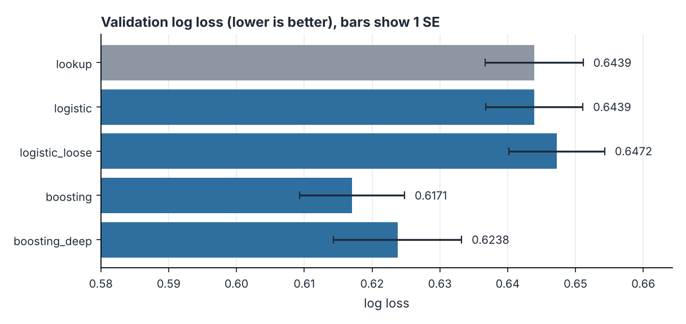
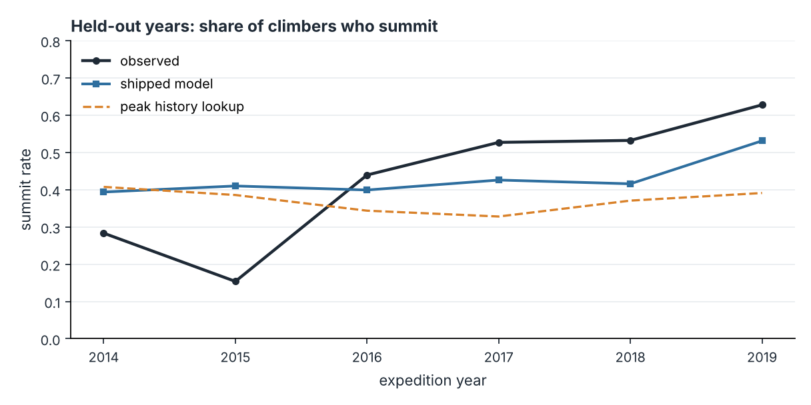
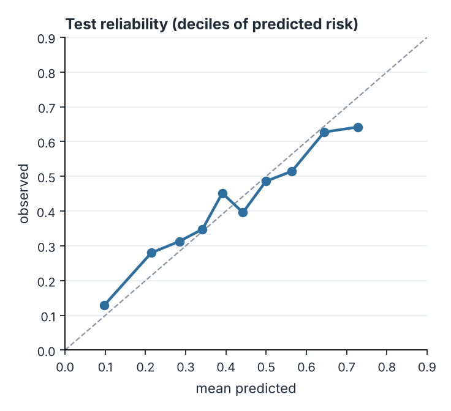
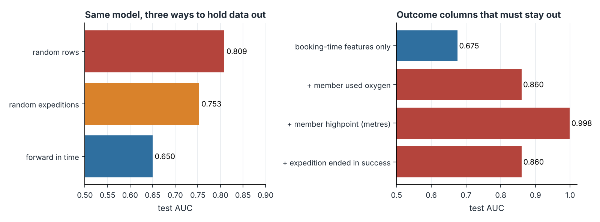
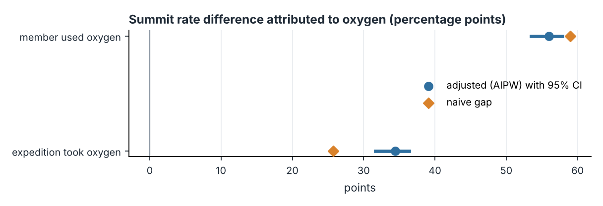
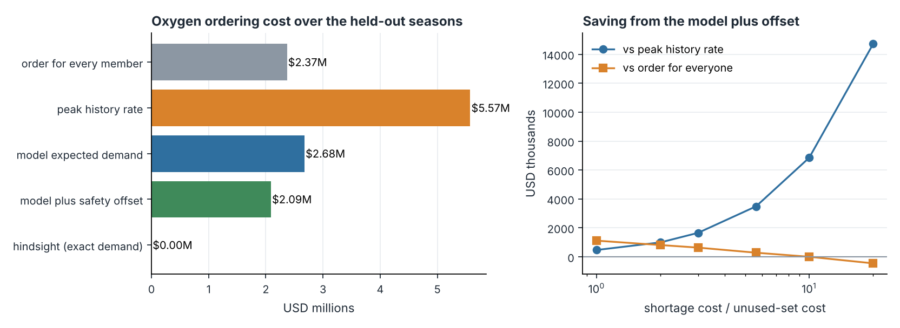
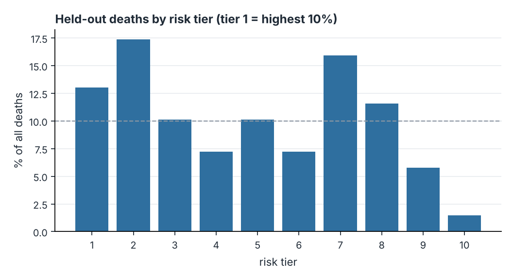

# icefall

[](https://github.com/ranjithguggilla/icefall/actions/workflows/ci.yml)

Booking-time summit odds, oxygen ordering and a careful look at what oxygen really does, built on the Himalayan Database records for expeditions in Nepal.

The database logs who went to which peak, when, with how much help, and how it ended. I used the 1950 to spring 2019 records for paying (non-hired) climbers, 60,521 of them on 387 peaks in 10,276 expeditions, to work on two forecasting problems and one causal question.

The forecasts are the chance that a climber reaches the summit, using only what is known when the trip is booked, and the number of oxygen sets an expedition on an 8,000 m peak will use. The causal question is what bottled oxygen does to a climber's odds. The raw answer is huge and mostly misleading, and most of the write-up below is about why.

The part I care about most is the evaluation. Climbers on one expedition share a fate (the intraclass correlation of the summit outcome is 0.47), outcome columns sit right next to the features, and the summit rate moved from 27.5% in the training years to 41.9% in the test years. I measured each of those instead of waving at them.

For scale, Alan Arnette's [season summary](https://www.alanarnette.com/2026/06/02/everest-2026-season-summary-records-crowds-trash-winds/) reports a record 495 Everest permits and 1,008 summits in 2026. This dataset stops in 2019, so none of that is in it. That is part of why I wanted to know how much a model fitted to the past can say about the next season.

## Results

Every number in this section is read from `outputs/metrics.json`, written by a single run of `icefall`. The test years are 2014 to 2019. No model choice, threshold or safety offset was tuned on them.

### Data and split

The split is forward in time, because a booking model is always used on years it has not seen.

| split | years | climbers | expeditions | summit rate |
|-------|-------|----------|-------------|-------------|
| train | 1950 to 2008 | 41,933 | 6,362 | 27.5% |
| valid | 2009 to 2013 | 9,162 | 2,057 | 39.0% |
| test | 2014 to 2019 | 9,426 | 1,857 | 41.9% |

### Summit odds at booking time

The features are the peak (id, height, years since first ascent), season, team size, hired staff above base camp, whether an agency was involved, age, sex, nationality, role, whether the climber was solo, and a point-in-time history of the peak: its success, death and oxygen rates over earlier years only, plus the same rates for all peaks in the preceding five years. Nothing that happens on the mountain is allowed in.

Validation scores, with the standard error from a bootstrap that resamples whole expeditions:

| model | log loss | SE | AUC | ECE |
|-------|----------|----|-----|-----|
| peak history lookup (no model) | 0.6439 | 0.0072 | 0.633 | 0.014 |
| logistic regression, C = 0.3 | 0.6439 | 0.0072 | 0.655 | 0.058 |
| logistic regression, C = 3 | 0.6472 | 0.0071 | 0.650 | 0.061 |
| gradient boosting, 15 leaves | 0.6170 | 0.0077 | 0.683 | 0.014 |
| gradient boosting, 40 leaves | 0.6238 | 0.0094 | 0.679 | 0.032 |



Gradient boosting with 15 leaves has the lowest validation log loss (0.6170). It is also the first model in my simplicity order inside one standard error of that score, so the one-standard-error rule picks it without a tie-break. The logistic regression ties the peak history lookup on log loss (0.6439) but ranks better (AUC 0.655 against 0.633) and is badly calibrated after the era shift (ECE 0.058).

The shipped model is refit on train plus validation and scored once on the test years:

| | AUC (95% interval) | log loss (95% interval) |
|---|---|---|
| gradient boosting | 0.675 (0.654 to 0.699) | 0.634 (0.617 to 0.651) |
| peak history lookup | 0.506 | 0.704 |

The log loss gain over the lookup is 0.0695 (0.0565 to 0.0841), Brier score 0.222, ECE 0.038. Intervals resample expeditions, not rows. An AUC of 0.675 is modest and I would not call this a model that picks winners. It is a calibrated base rate with some useful adjustments.

Across the whole test period the model is almost exactly right on average (mean prediction 42.1%, observed 41.9%). Year by year it is not:

| year | climbers | observed | model | peak history lookup |
|------|----------|----------|-------|---------------------|
| 2014 | 1,624 | 28.3% | 39.4% | 40.8% |
| 2015 | 1,528 | 15.4% | 41.0% | 38.6% |
| 2016 | 1,748 | 43.9% | 39.9% | 34.4% |
| 2017 | 1,782 | 52.7% | 42.6% | 32.8% |
| 2018 | 1,847 | 53.2% | 41.6% | 37.1% |
| 2019 | 897 | 62.8% | 53.1% | 39.1% |



Summit rates fell to 15.4% in 2015 and climbed to 62.8% in 2019. The 2014 icefall avalanche and the 2015 earthquake both happened in April, and nothing known at booking time can see either. I did not try to explain the climb after 2016, and a model whose features stop at the peak and the team cannot extrapolate it. I would use the output as a ranking and a mix adjustment, and re-anchor its level on the current season's base rate.

Temperature scaling fitted on the validation years moves the train-only model's test log loss from 0.6510 to 0.6474 and its ECE from 0.045 to 0.036 (temperature 0.923). That is a small gain, so I left the shipped model uncalibrated.



The largest peaks in the test years, with the model's average prediction next to the observed rate and the AUC inside that peak:

| peak | climbers | observed | predicted | AUC within peak |
|------|----------|----------|-----------|-----------------|
| Everest | 3,040 | 48.8% | 58.0% | 0.681 |
| Ama Dablam | 1,569 | 42.8% | 42.6% | 0.572 |
| Manaslu | 934 | 49.9% | 37.9% | 0.678 |
| Cho Oyu | 620 | 52.3% | 31.8% | 0.588 |
| Lhotse | 468 | 31.2% | 38.9% | 0.740 |
| Himlung Himal | 380 | 39.0% | 35.8% | 0.598 |
| Makalu | 302 | 33.1% | 27.2% | 0.674 |
| Dhaulagiri I | 226 | 22.1% | 28.9% | 0.742 |

The model leans on history, so it over-predicts Everest (58.0% against 48.8%) and under-predicts Cho Oyu (31.8% against 52.3%).

### How much of an AUC is real

The same boosting model, trained on rows from every year and held out three different ways:

| hold-out | train rows | test rows | AUC | log loss |
|----------|------------|-----------|-----|----------|
| random rows | 48,416 | 12,105 | 0.809 | 0.486 |
| random expeditions | 48,283 | 12,238 | 0.753 | 0.540 |
| forward in time | 41,933 | 9,426 | 0.650 | 0.651 |

Random rows put teammates on both sides of the split, and because the history features are identical for everyone on a peak in a given year, the model can recognise an expedition and copy its result. The AUC is 0.809 there, 0.753 when whole expeditions are held out, and 0.650 going forward in time. About 0.16 of the random-split AUC is not skill. (The forward row is the train-only model, which is why it reads 0.650 and not the 0.675 of the refit model above.)

Then the columns that must stay out. I added each to the booking-time features one at a time and scored the same test years:

| scenario | AUC |
|----------|-----|
| booking-time features only | 0.675 |
| + member used oxygen | 0.860 |
| + member highpoint (metres) | 0.999 |
| + expedition ended in success | 0.860 |



A climber's recorded highpoint takes the AUC to 0.999, which is the outcome written down twice. Whether a member used oxygen and whether the expedition ended in success are less blatant and still add about 0.18 and 0.18 AUC. None of them is available when someone books a trip.

Dependence inside expeditions also changes how much to trust the intervals. On the test years the summit outcome has an intraclass correlation of 0.472 with about 5.1 climbers per expedition, a design effect of 2.93, so the 9,426 test rows carry roughly the information of 3,221 independent ones. A row-level bootstrap gives an AUC interval of 0.666 to 0.686. Resampling expeditions gives 0.654 to 0.699, which is 2.25 times wider. Every interval in this repo uses the second kind.

### What oxygen does

For this part I took climbers on peaks of 8,000 m or more since 1980: 33,087 people on 5,584 expeditions. Adjustment covers the peak (ten largest, rest pooled), a five-year era, age, sex, role, season, nationality, team size and hired staff. Estimates are risk differences in percentage points from four estimators: the raw gap, g-computation, inverse probability weighting and the doubly robust AIPW estimator, whose interval comes from resampling expeditions.

| comparison | naive | g-computation | IPW | AIPW (95% interval) |
|------------|-------|---------------|-----|---------------------|
| member used oxygen, summit | +59.0 | +61.3 | +54.0 | +56.0 (+53.5 to +57.8) |
| member used oxygen, died | +0.2 | +1.0 | +1.3 | +1.3 (+0.7 to +2.0) |
| expedition took oxygen, summit | +25.7 | +25.1 | +31.4 | +34.5 (+31.7 to +36.4) |
| expedition took oxygen, died | -0.3 | +0.3 | +0.4 | +0.3 (-0.1 to +0.7) |



The first row is the number everyone quotes: climbers who used oxygen summited 73.0% of the time against 14.1% for those who did not. Adjusting barely changes it (+59.0 to +56.0), and I do not read that as reassurance. Whether a member used oxygen is decided on the mountain. A climber who turns back at camp two never opens a bottle, so the comparison mostly sorts people by how high they got. The same logic explains the death row: oxygen users appear to die +1.3 points more often (+0.7 to +2.0), which says the people who reach the death zone are the ones using oxygen, and says nothing about oxygen being dangerous.

The E-value for the raw summit risk ratio (5.19) is 9.85, meaning an unmeasured confounder would need a risk ratio of that size with both oxygen and summiting to explain it away. That sounds comforting and misses the point, because the problem here is the timing of the treatment, which a confounder bound does not address.

The expedition-level comparison is closer to a decision someone makes before leaving: did the team use oxygen (57.8% of climbers were on teams where somebody did). It is still recorded after the fact, since a team turned back below the high camps may never open a bottle, so I read it as an upper bound. The gap is +25.7 points raw and +34.5 (+31.7 to +36.4) adjusted, so adjusting made it larger. Teams with oxygen are concentrated on the highest peaks (67% of their climbers were on Everest or Lhotse against 23% of the others, mean peak height 8,636 m against 8,346 m), where summiting is harder, and inside each peak the gap is wide:

| peak | climbers on oxygen teams | summit rate | climbers on other teams | summit rate |
|------|--------------------------|-------------|-------------------------|-------------|
| Everest | 11,816 | 42.3% | 2,391 | 2.0% |
| Lhotse | 1,019 | 43.3% | 780 | 14.2% |
| Cho Oyu | 2,784 | 51.0% | 4,508 | 28.8% |
| Manaslu | 1,331 | 53.8% | 1,889 | 17.4% |
| Makalu | 667 | 31.0% | 1,106 | 14.4% |
| Dhaulagiri I | 486 | 30.9% | 1,483 | 17.2% |

Deaths at the expedition level: +0.3 points (-0.1 to +0.7), an interval that includes zero.

Checks. Shuffling the member-level treatment and re-running my AIPW estimator ten times gives +0.004 points on average with a standard deviation of 0.37. dowhy, on a random sample of 8,000 climbers, gives +61.6 with linear regression and +55.2 with stabilised weighting, and adding a random confounder leaves both unchanged. Its placebo refuter returns +0.06 for the regression estimator, as it should. For the weighting estimator it returns -19.4 in this run and landed near -19 points every time I ran it, and I could not trace why. I take the headline from my own estimator, which passes its placebo, and report dowhy's weighting number as a flag and not as a pass.

### Ordering oxygen

The operational question is how many sets to bring. On the test years there were 1,095 expeditions on 8,000 m peaks with 5,840 paying climbers, who used 2,878 sets between them. A probability model for each climber's oxygen use reaches an AUC of 0.731. Summing it over a team gives an expedition-level expectation with a mean absolute error of 1.35 sets, against 2.00 for the peak's recent oxygen rate times team size.

Costs are my assumptions and not data: $800 for each set carried and not used, $4,500 for each set a climber needed and did not have (an emergency purchase or a turn-around). The safety offset adds 0.85 sets per expedition, which is the 85th percentile of the validation residuals, the quantile where the marginal cost of a surplus set meets that of a shortage.

| policy | sets ordered | unused | short | total cost | per climber |
|--------|--------------|--------|-------|------------|-------------|
| order for every member | 5,840 | 2,962 | 0 | $2,369,600 | $406 |
| peak history rate | 2,950 | 1,113 | 1,041 | $5,574,900 | $955 |
| model expected demand | 3,745 | 1,241 | 374 | $2,675,800 | $458 |
| model plus safety offset | 4,310 | 1,610 | 178 | $2,089,000 | $358 |
| hindsight (exact demand) | 2,878 | 0 | 0 | $0 | $0 |



The model with the offset costs $358 per climber. That is $48 less than bringing a set for every climber ($280,600 over the test years, 95% interval $56,690 to $500,192) and $597 less than following the peak's recent rate ($3,485,900, interval $3,066,710 to $3,878,482). The ordering of policies depends on the assumed cost ratio, so here is the sweep:

| missing / unused cost ratio | offset (sets) | saving vs one for everyone | saving vs peak history rate |
|-----------------------------|---------------|----------------------------|-----------------------------|
| 1.0 | -0.06 | $1,114,400 | $468,000 |
| 2.0 | +0.15 | $809,600 | $996,000 |
| 3.0 | +0.41 | $633,600 | $1,652,800 |
| 5.6 | +0.85 | $280,600 | $3,485,900 |
| 10.0 | +1.37 | -$800 | $6,848,000 |
| 20.0 | +1.98 | -$454,400 | $14,722,400 |

Ordering a set for everyone is hard to beat once a missing set costs about ten times an unused one: at a ratio of 10 the model is $800 behind it and at 20 it is $454,400 behind. The plain rule is a good policy for a cautious operator. The model earns its place when waste matters.

### Death risk

The same booking-time features give a weak ranking of who dies: test AUC 0.580 (0.502 to 0.654) on 69 deaths among 9,426 climbers (0.73%), against 0.539 for the peak's recent death rate. The highest-risk tenth of climbers holds 13.0% of the deaths and the top two tenths hold 30.4%, where chance would give 10% and 20%. The model also predicts 1.04% on average against 0.73% observed, because deaths per climber fell over the period. I would not use it to decide anything.



## Business read

For an operator, the useful outputs are a calibrated base rate for each booking and an oxygen order that is allowed to be a little generous. At the assumed costs the order saves $48 per climber against the simplest rule, which is small next to what a client pays for a trip and large next to the margin on a logistics line. The result is sensitive to the cost ratio, so the first thing to do with real invoices is replace my two numbers.

For anyone reading summit statistics, the headline oxygen gap of +59.0 points is not a treatment effect. The better-posed expedition-level estimate is +34.5 points, which is still observational and still an upper bound.

For a team that wants to use a model like this, the 27.5% to 41.9% drift matters more than another point of AUC. Re-anchoring the level on the current season and watching year-level error would protect against more than extra tuning.

## Architecture

```
 data/raw/*.csv.gz
        |
        v
 data.build_table ----> non-hired climbers, booking-time columns + outcomes kept apart
        |
        v
 data.prior_rate_features   (rates from strictly earlier years, shrunk, cold start constants)
        |
        +-----------------------+---------------------------+--------------------------+
        |                       |                           |                          |
        v                       v                           v                          v
 evaluate.select_model   evaluate audits            oxygen.causal_frame        oxygen.expedition_demand
 (one-SE rule on         split study, leakage,      8,000 m peaks, 1980 on     sum of member probabilities
  validation)            dependence (ICC)                   |                          |
        |                       |                           v                          v
        v                       |                  naive / g-comp / IPW / AIPW   newsvendor offset
 holdout_report                 |                  dowhy + permutation placebo   (validation residuals)
 (cluster bootstrap)            |                           |                          |
        |                       |                           |                          |
        +-----------------------+---------------------------+--------------------------+
                                        |
                                        v
              outputs/metrics.json, outputs/tables/*.csv, assets/*.png
                                        |
                                        v
              outputs/bundle.joblib ----> score.score_climber ----> Gradio app
```

## Installation

Python 3.11 or newer. I ran everything on 3.13 with the versions pinned in `requirements.txt`.

```bash
git clone https://github.com/ranjithguggilla/icefall.git
cd icefall
python -m venv .venv
source .venv/bin/activate
pip install -r requirements.txt
pip install -e . --no-deps
```

For tests and lint add `pip install -r requirements-dev.txt`.

## Usage

1. Run the whole pipeline. It reads the files in `data/raw/`, trains and scores everything and writes the outputs. It took about four minutes in my sandbox.

   ```bash
   icefall
   ```

   `icefall --fast` uses fewer bootstrap draws and skips the dowhy cross-check. The tests use it.

2. Read `outputs/metrics.json` for every number, `outputs/tables/` for the tables behind the charts and `assets/` for the charts.

3. Compare a fresh run with the committed numbers:

   ```bash
   cp outputs/metrics.json /tmp/committed.json
   icefall
   python -m icefall.verify /tmp/committed.json outputs/metrics.json
   ```

   Everything in the file is reproduced to the digit by a second run except the randomised refuter values from dowhy, which `verify` ignores.

4. Start the app. It loads `outputs/bundle.joblib`, so run step 1 first.

   ```bash
   icefall-app
   ```

   Gradio serves on http://127.0.0.1:7860 by default.

5. Or score a climber from Python:

   ```python
   from icefall import score

   bundle = score.load_bundle()
   peak_id = bundle.peaks.set_index("peak_name").loc["Everest", "peak_id"]
   result = score.score_climber(
       bundle, peak_id, season="Spring", age=42, sex="M", citizenship="USA",
       role="climber", team_size=12, hired_staff=14, has_agency=1,
   )
   ```

   which returns, from the bundle in this repo's last run:

   ```
   {
     "peak": "Everest",
     "height_m": 8850,
     "p_summit": 0.774,
     "band": "favourable",
     "p_oxygen": 0.847,
     "p_death": 0.003,
     "reasons": [
       "The hired support adds about 19.6 points compared with a typical climber.",
       "The peak adds about 16.5 points compared with a typical climber.",
       "The season adds about 10.5 points compared with a typical climber."
     ],
     "peak_recent_rate": 0.54
   }
   ```

   The reasons come from swapping one input at a time to a typical value and reporting how far the estimate moves. They describe the model, not a causal effect.

## Configuration

Everything adjustable lives in `src/icefall/config.py`.

| setting | default | what it does |
|---------|---------|--------------|
| `TRAIN_END`, `VALID_END` | 2008, 2013 | last year of the training and validation windows; the test window is every later year |
| `MIN_YEAR` | 1950 | first expedition year kept |
| `EIGHT_THOUSANDER` | 8000 | height in metres that defines the oxygen analyses |
| `SEED` | 7 | seed for models and bootstraps |
| `COSTS.unused_set` | 800 | USD per oxygen set carried and not used |
| `COSTS.missing_set` | 4500 | USD per set needed and not available |

The cost ratio sweep in the results shows what happens when the two cost numbers move. History features use a five-year window and a shrinkage weight of 20 earlier climbers; both are arguments to `data.prior_rate_features`.

## Output structure

```
outputs/
  metrics.json              every number quoted in this README
  bundle.joblib             models and peak table used by the app (not committed)
  tables/
    model_selection.csv     validation scores per candidate
    test_by_year.csv        observed against predicted summit rate per test year
    test_by_peak.csv        same, for the largest peaks
    split_study.csv         random rows vs random expeditions vs forward in time
    leak_study.csv          AUC when each outcome-side column is added
    oxygen_by_peak.csv      summit rate with and without an oxygen team, per peak
    oxygen_policies.csv     ordering policies and their costs
    oxygen_cost_sweep.csv   savings across missing / unused cost ratios
    death_tiers.csv         observed deaths by predicted risk tier
assets/                     the charts embedded above
```

## Project structure

```
icefall/
  src/icefall/
    config.py       paths, split years, cost assumptions
    data.py         load, filter, point-in-time peak history, forward split
    models.py       feature lists, pipelines, ECE and score helpers
    stats.py        expedition-level bootstrap and intraclass correlation
    evaluate.py     selection, hold-out report, split / leakage / dependence studies
    oxygen.py       causal estimators, dowhy check, ordering policies
    score.py        bundle, single-climber scoring and reasons
    app.py          Gradio front end
    pipeline.py     the end-to-end run (`icefall`)
    plots.py        chart code
    verify.py       compare a fresh metrics file with the committed one
  tests/            59 tests
  data/raw/         trimmed Himalayan Database extract
  .github/workflows/ci.yml
```

## Technical details

The history features are the main thing keeping the evaluation honest. For a climber in year Y on peak P they use only outcomes from years before Y: cumulative rates and a five-year window, each shrunk towards the all-peak rate of the same period with a weight of 20 climbers, plus counts. The first years have no earlier data and use fixed constants instead of the dataset's overall rate, which would have looked forward. A test (`test_history_never_sees_its_own_year`) flips an outcome in one year and checks that no feature of that year or earlier moves. It failed on the first version, which is how I found the fallback leaking.

The linear models take log-scaled counts, a median-imputed age with a missingness flag, and one-hot categories with rare levels pooled. The boosted models are scikit-learn's histogram gradient boosting with native categorical handling, early stopping on a 15% slice of the training rows and a fixed seed. Citizenship keeps its 14 most common levels and peaks keep 120; the levels are learned inside the pipeline so each fit sees only its own training rows.

Selection uses validation log loss and the one-standard-error rule, with the standard error from 400 bootstrap draws over expeditions. The simplicity order is lookup, the two logistic models, then the two boosted ones.

The causal frame keeps climbers on 8,000 m peaks from 1980. Propensities are a logistic regression on the confounders and are clipped to 0.02 to 0.98. The outcome model is a logistic regression with the treatment as a covariate. AIPW combines the two; its interval resamples 120 times over expeditions.

Oxygen ordering follows the newsvendor logic. The offset is a quantile of validation residuals (actual demand minus summed probabilities) at 0.849, the share of the total cost carried by a shortage, applied on top of the expected demand and capped at team size. The offset and the model are chosen on validation years and scored on the test years.

The bundle used by the app is refit on every year available, including the test years, so the app's numbers are not held-out numbers.

Limits worth stating. The data has no climber identity across expeditions, so experience, which I expect matters a lot, is invisible. Hired staff are excluded, so nothing here applies to Sherpa climbers. There is no weather, no route-fixing date and no cancellation information. The test period contains two shock years. The dollar figures rest on cost assumptions I picked. The app is an illustration, not safety advice.

## Testing

```bash
pip install -r requirements-dev.txt
ruff check src tests
pytest -q --cov=icefall
```

59 tests pass with 98% coverage in my last run. They cover the point-in-time features (including the flipped-outcome check), the bootstrap and intraclass correlation on synthetic data with known answers, model fitting and the one-standard-error rule, the oxygen cost and newsvendor arithmetic, the causal estimators (a shuffled treatment must give about zero), single-climber scoring and the app text, the metrics comparison, and an end-to-end `--fast` run that checks every chart and the bundle get written. CI runs lint and tests on every push and pull request. On `main` it also reruns the full pipeline, compares the result with the committed `outputs/metrics.json` and uploads the run as an artifact.

## Dataset

The Himalayan Database, compiled from Elizabeth Hawley's expedition archives and cleaned by Alex Cookson, as distributed by the TidyTuesday project (2020, week 39): https://github.com/rfordatascience/tidytuesday/tree/main/data/2020/2020-09-22. I kept a trimmed copy in `data/raw/` so the repo runs offline. The database is a separate project with its own terms; check https://www.himalayandatabase.com before reusing the data beyond this analysis.

## License

MIT, see `LICENSE`.
